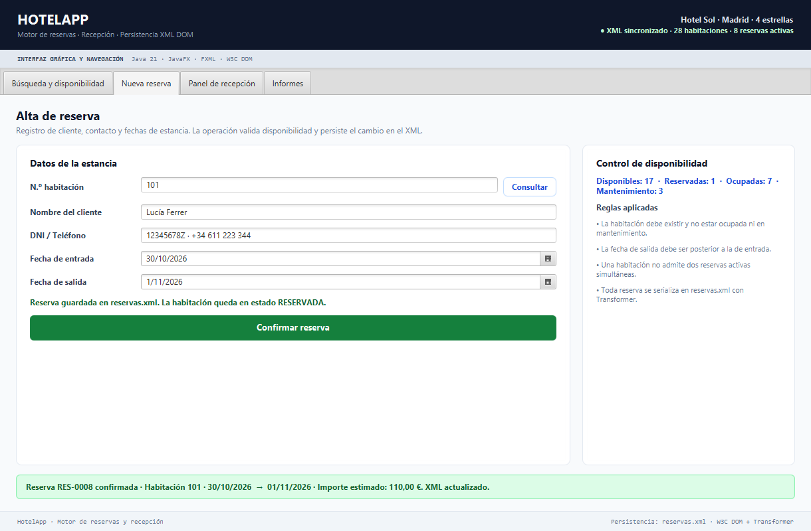
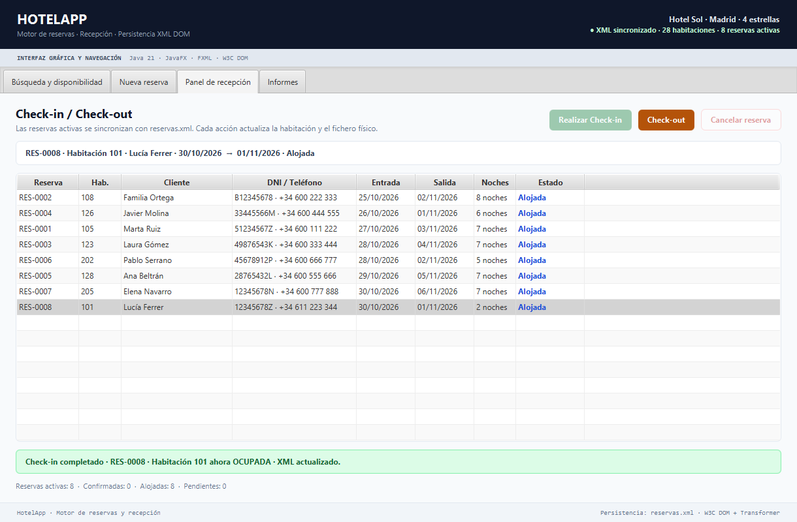
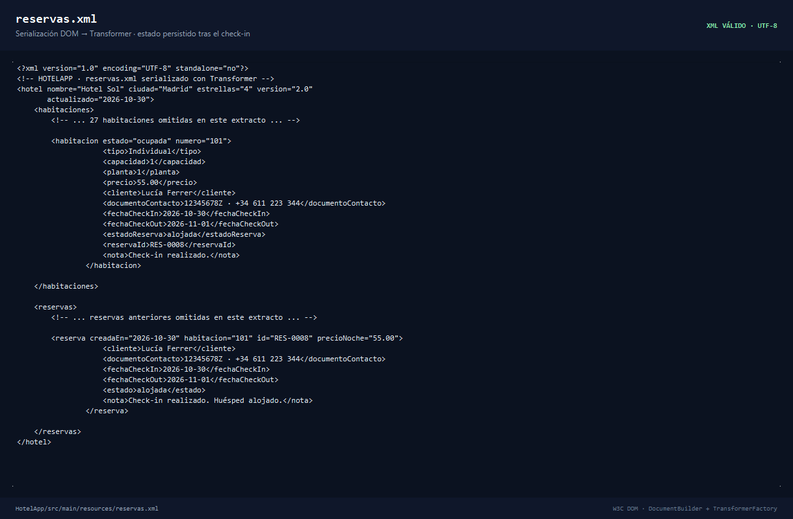

# HotelApp v2 — Motor de Reservas, Check-in y Persistencia XML DOM


## Resumen ejecutivo

**HotelApp v2** evoluciona el visor de disponibilidad de la Parte 1 hacia una plataforma integral de reservas y recepción. La aplicación incorpora un motor de escritura XML bidireccional, un ciclo completo de check-in/check-out y una interfaz JavaFX organizada por pestañas, manteniendo el tema Modena y sin depender de bases de datos externas.

El fichero `reservas.xml` actúa como fuente de verdad. Cada operación de negocio modifica el árbol DOM en memoria y lo serializa de nuevo a disco con `TransformerFactory` + `Transformer`, por lo que el estado sobrevive al cierre y reinicio de la aplicación.

| Capacidad | Implementación |
| :--- | :--- |
| Consulta y filtrado | Búsqueda por número y filtro por estado (`disponible`, `reservada`, `ocupada`, `mantenimiento`) |
| Alta de reservas | Cliente, DNI/teléfono, fechas de entrada y salida, validación temporal y control de duplicados |
| Recepción | Check-in, check-out y cancelación con actualización inmediata de la habitación |
| Persistencia | Lectura DOM (`DocumentBuilder`) y escritura normalizada (`Transformer`) sobre `reservas.xml` |
| Interfaz | `TabPane` con cuatro módulos, `TableView` + `ObservableList` y feedback visual verde/rojo/ámbar |

## Evidencias visuales

| Módulo | Captura | Qué demuestra |
| :--- | :--- | :--- |
| Alta de reserva |  | Formulario con `DatePicker`, validación de fechas y confirmación persistida de la reserva `RES-0008`. |
| Panel de recepción |  | Check-in en tiempo real: la reserva pasa a `alojada` y la habitación 101 a `ocupada`. |
| Persistencia XML |  | Árbol DOM serializado en `reservas.xml` con la habitación y la reserva sincronizadas tras la operación. |

## Decisiones de arquitectura e ingeniería

### 1. Persistencia bidireccional DOM

- **Lectura:** `DocumentBuilderFactory` + `DocumentBuilder` parsean `reservas.xml` y construyen los modelos `Habitacion` y `Reserva`.
- **Escritura:** `TransformerFactory`, `Transformer`, `DOMSource` y `StreamResult` serializan el documento completo con codificación UTF-8 e indentación de cuatro espacios.
- **Integridad:** la escritura se realiza sobre un fichero temporal y se mueve con `ATOMIC_MOVE` (con fallback a `REPLACE_EXISTING`), evitando dejar un XML truncado si falla la operación.
- **Seguridad:** se desactivan DTDs, entidades externas y acceso a recursos externos para mitigar ataques XXE.
- **Compatibilidad:** si la aplicación se ejecuta desde `target/classes`, la escritura se replica en `src/main/resources` para conservar los datos entre ejecuciones.

### 2. Patrón MVC reactivo

| Capa | Responsabilidad |
| :--- | :--- |
| `Main.java` | Arranque de JavaFX y carga de `vista.fxml`. |
| `Controlador.java` | Navegación, eventos, validaciones, mensajes y sincronización de las tablas. |
| `GestorXml.java` | Servicio de persistencia y reglas transaccionales sobre el XML. |
| `Habitacion.java` | Modelo físico y estado operativo de cada habitación. |
| `Reserva.java` | Modelo de estancia, cliente, fechas y estado de la reserva. |
| `vista.fxml` | Controles, `TabPane`, `TableView`, `DatePicker` y estilos puntuales Modena. |

La interfaz no contiene lógica de negocio. Las `ObservableList` alimentan las `TableView` y se recargan desde el XML después de cada operación, de modo que la vista refleja siempre el estado persistido.

### 3. Gestión de estados transicionales

```text
Habitación:
disponible ──reserva──▶ reservada ──check-in──▶ ocupada ──check-out──▶ disponible
     │
     └──mantenimiento (fuera del flujo de reservas)

Reserva:
pendiente ──confirmación──▶ confirmada ──check-in──▶ alojada ──check-out──▶ finalizada
                                  │
                                  └──cancelación──▶ cancelada
```

- `reservada` es el estado transitorio de una habitación con reserva confirmada pendiente de entrada.
- El check-in solo se permite desde una reserva confirmada, con la habitación no ocupada ni en mantenimiento y con la fecha de entrada cumplida.
- El check-out libera la habitación y finaliza la reserva sin eliminar el histórico del XML.
- La cancelación solo afecta a reservas confirmadas o pendientes.

### 4. Validaciones y manejo de excepciones

- Número de habitación existente y positivo.
- Habitación no ocupada y no en mantenimiento.
- Una única reserva activa por habitación.
- Salida estrictamente posterior a la entrada.
- Entrada no anterior a la fecha actual.
- Nombre de cliente y contacto con longitud mínima.
- Mensajes visuales con color: verde para éxito, rojo para error y ámbar para advertencias.
- Las excepciones de parsing, transformación y E/S se encapsulan en `GestorXml.GestorXmlException` y se muestran en la interfaz sin cerrar la aplicación.

### 5. Interfaz y navegación

- `TabPane` principal con cuatro pestañas: búsqueda, nueva reserva, recepción e informes.
- Navegación sin ventanas secundarias y sin CSS externo.
- Tema Modena con acentos puntuales declarados en el FXML.
- Tablas con celdas de estado coloreadas y resumen inferior dinámico.
- `DatePicker` con bloqueo de fechas inválidas y ajuste automático de la salida.

## Estructura del proyecto

```text
HotelApp/
├── pom.xml
├── README.md
├── docs/
│   └── capturas/
│       ├── hotel_v2_reserva.png
│       ├── hotel_v2_checkin.png
│       └── hotel_v2_xml.png
└── src/
    └── main/
        ├── java/com/hotelapp/
        │   ├── Main.java
        │   ├── Controlador.java
        │   ├── GestorXml.java
        │   ├── Habitacion.java
        │   └── Reserva.java
        └── resources/
            ├── vista.fxml
            └── reservas.xml
```

## Esquema XML

```xml
<hotel nombre="Hotel Sol" ciudad="Madrid" estrellas="4" version="2.0">
    <habitaciones>
        <habitacion numero="105" estado="ocupada">
            <tipo>Doble</tipo>
            <capacidad>2</capacidad>
            <planta>1</planta>
            <precio>75.00</precio>
            <cliente>Marta Ruiz</cliente>
            <documentoContacto>51234567Z · +34 600 111 222</documentoContacto>
            <fechaCheckIn>2026-10-27</fechaCheckIn>
            <fechaCheckOut>2026-11-03</fechaCheckOut>
            <estadoReserva>alojada</estadoReserva>
            <reservaId>RES-0001</reservaId>
        </habitacion>
    </habitaciones>

    <reservas>
        <reserva id="RES-0001" habitacion="105" precioNoche="75.00" creadaEn="2026-10-27">
            <cliente>Marta Ruiz</cliente>
            <documentoContacto>51234567Z · +34 600 111 222</documentoContacto>
            <fechaCheckIn>2026-10-27</fechaCheckIn>
            <fechaCheckOut>2026-11-03</fechaCheckOut>
            <estado>alojada</estado>
            <nota>Huésped alojado. Check-out previsto para el 03/11/2026.</nota>
        </reserva>
    </reservas>
</hotel>
```

## Ejecución

Requisitos:

- JDK 21 o superior.
- Apache Maven 3.9 o superior.

```bash
cd HotelApp
mvn clean compile
mvn clean javafx:run
```

Para abrir la aplicación desde un IDE, ejecuta la clase `com.hotelapp.Main` con el JDK 21 configurado.

La ruta del XML puede sobreescribirse con una propiedad del sistema:

```bash
mvn javafx:run -Dhotelapp.xml=/ruta/a/reservas.xml
```

## Casos de prueba validados

| ID | Escenario | Acción | Resultado esperado | Persistencia |
| :--- | :--- | :--- | :--- | :--- |
| CP-01 | Compilación | `mvn clean compile` | `BUILD SUCCESS` sin errores | N/A |
| CP-02 | Carga inicial | Abrir la aplicación | 28 habitaciones y 7 reservas alojadas | Lectura DOM correcta |
| CP-03 | Búsqueda disponible | Buscar `101` | Mensaje verde: disponible, precio y capacidad | Sin cambios |
| CP-04 | Búsqueda inexistente | Buscar `999` | Mensaje rojo: la habitación no existe | Sin cambios |
| CP-05 | Habitación ocupada | Buscar `105` | Mensaje rojo y ficha de huésped/fechas | Sin cambios |
| CP-06 | Mantenimiento | Buscar `103` | Mensaje ámbar: fuera de servicio | Sin cambios |
| CP-07 | Alta válida | Habitación `101`, cliente y fechas válidas | Reserva `RES-0008`, habitación `reservada` | XML actualizado |
| CP-08 | Doble reserva | Repetir reserva sobre `101` | Error: ya tiene una reserva activa | Sin escritura |
| CP-09 | Habitación ocupada | Reservar `105` | Error: está ocupada | Sin escritura |
| CP-10 | Mantenimiento | Reservar `103` | Error: no puede reservarse | Sin escritura |
| CP-11 | Fechas inválidas | Salida anterior o igual a la entrada | Error de validación temporal | Sin escritura |
| CP-12 | Check-in | Seleccionar `RES-0008` y pulsar Check-in | Reserva `alojada`, habitación `101` ocupada | XML actualizado |
| CP-13 | Check-out | Seleccionar la reserva alojada y pulsar Check-out | Reserva `finalizada`, habitación disponible | XML actualizado |
| CP-14 | Cancelación | Cancelar una reserva confirmada | Reserva `cancelada`, habitación liberada | XML actualizado |
| CP-15 | Reinicio | Cerrar y volver a abrir la aplicación | Se conservan los cambios anteriores | Lectura del XML |
| CP-16 | XML mal formado | Corromper el archivo y arrancar | Mensaje de error controlado, sin excepción no capturada | N/A |

**Resultado de la batería de servicio:** 18 comprobaciones ejecutadas, 0 fallos, incluyendo alta, bloqueo de duplicados, check-in, check-out, cancelación y recarga del XML serializado.

## Alcance técnico

- Aplicación de escritorio mono-usuario con persistencia local en XML.
- No requiere servidor, base de datos ni servicios externos.
- El histórico de reservas finalizadas o canceladas permanece en `reservas.xml`.
- La interfaz se mantiene deliberadamente sobria y funcional, priorizando la claridad operativa de recepción.

---

**Contexto académico:** Proyecto de HotelApp · Grupo 7 (Mohamed, Sergio y Pablo) · Módulo de Desarrollo de Interfaces · Java 21 + JavaFX + W3C DOM.
